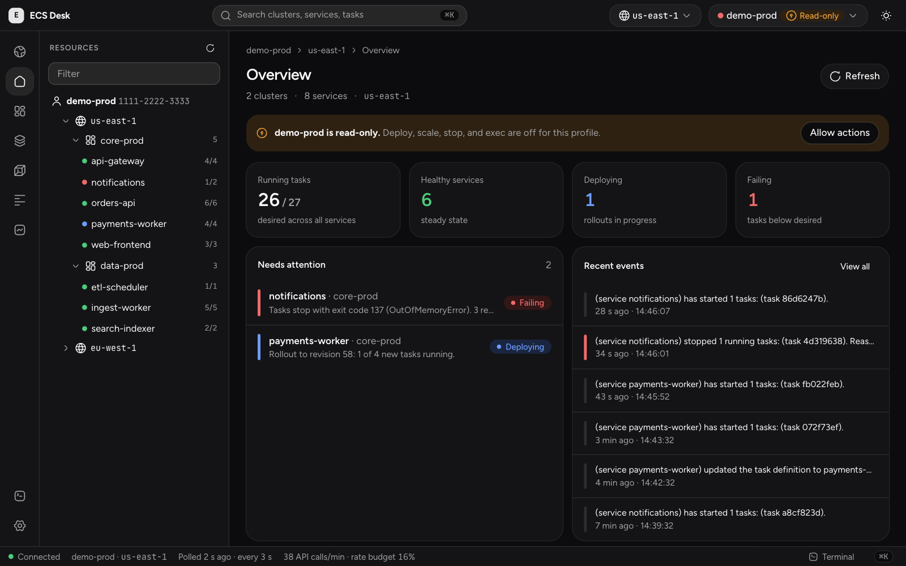
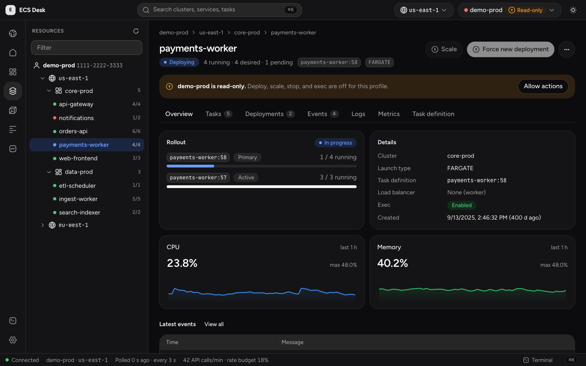
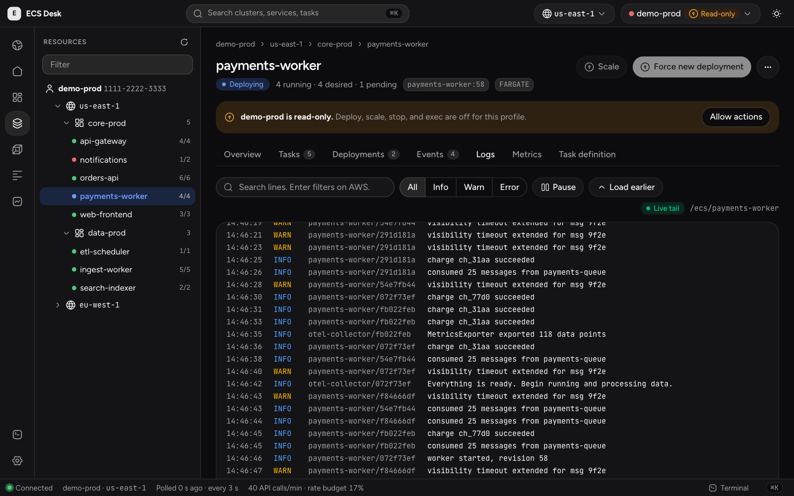
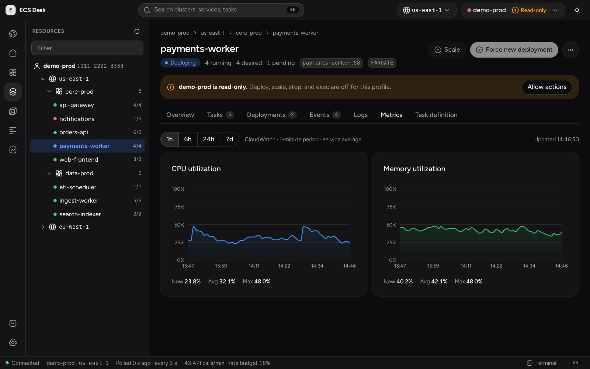
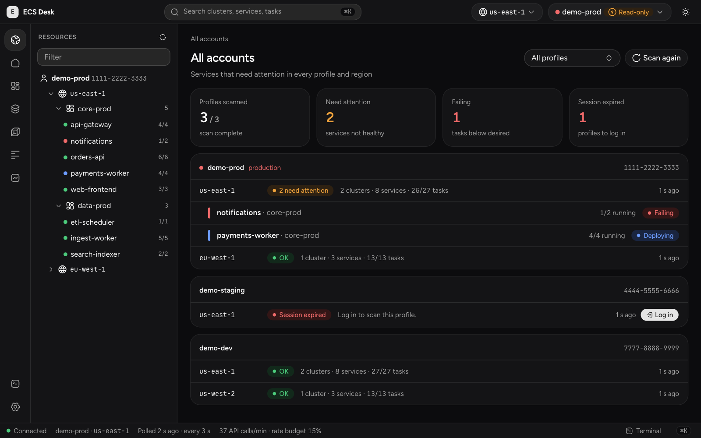
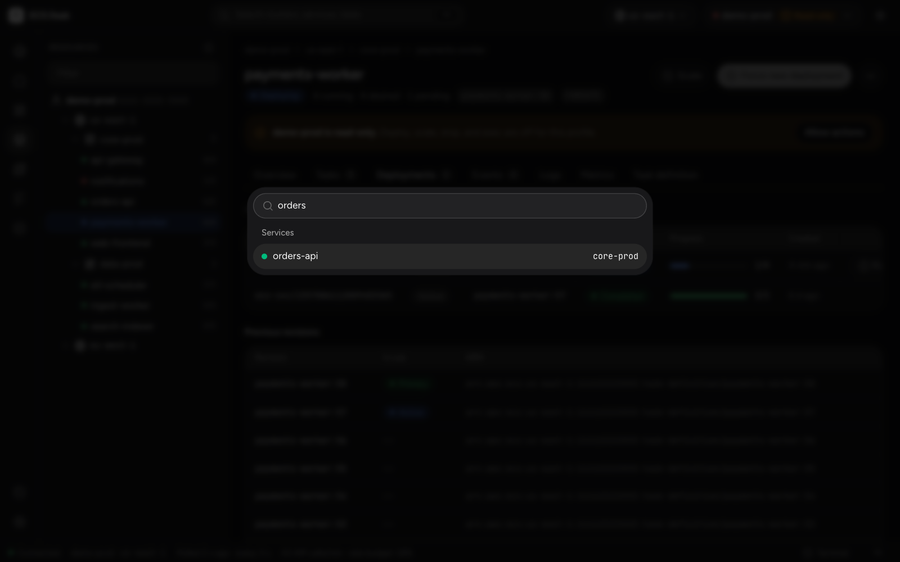
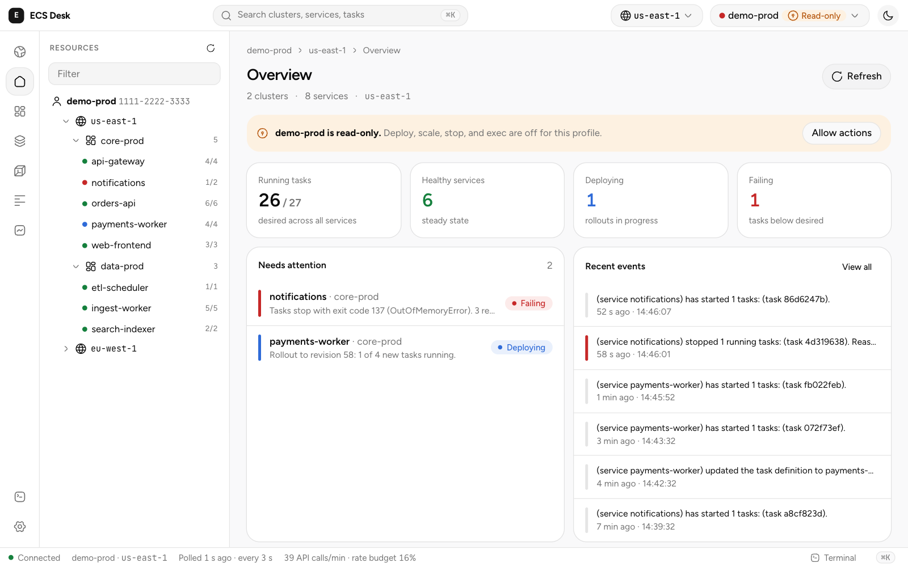

<div align="center">

# 🖥️ ECS Desk

**A desktop app for AWS ECS, similar to Lens for Kubernetes.**

See clusters, services, tasks, logs, and metrics on one screen.
Exec into containers and deploy in one click.

[](https://github.com/sanjeepan23/ecs-desk/actions/workflows/ci.yml)
[](LICENSE)




</div>

> [!NOTE]
> "ECS Desk" is a working name. The screenshots show the example data that `pnpm dev` uses. They do not show a real AWS account.

## ✨ Features

| | Feature | What it does |
| --- | --- | --- |
| 🗺️ | **One view for each region** | See clusters, services, and tasks in a resource tree. The overview shows the services that need attention. |
| 🔍 | **Service details** | See rollout progress, events, tasks, logs, metrics, and the task definition on one page. |
| 📜 | **Live logs** | Tail CloudWatch Logs for a service. Filter by level, search lines, pause, and load earlier lines. |
| 📈 | **Metrics** | See CPU and memory charts from CloudWatch for 1 h, 6 h, 24 h, or 7 d. |
| ⚡ | **Actions** | Scale a service, force a new deployment, roll back, and stop tasks. |
| 💻 | **Exec** | Open a shell in a running container with ECS Exec. |
| 🛑 | **Stopped tasks** | Group stopped tasks by cause, for example out of memory or failed health checks. |
| 🚀 | **Deploy watch** | Follow a rollout and get a desktop notification when it ends or fails. |
| 🌍 | **All accounts** | Scan every AWS profile and region, and list the services that are not healthy. |
| ⌨️ | **Command palette** | Press `⌘K` to go to any cluster, service, or task. |
| 🌗 | **Themes** | Use the light theme, the dark theme, or follow the system. |

## 📸 Screenshots

<table>
  <tr>
    <td width="50%"><b>🔍 Service details</b><br></td>
    <td width="50%"><b>📜 Live logs</b><br></td>
  </tr>
  <tr>
    <td><b>📈 Metrics</b><br></td>
    <td><b>🌍 All accounts</b><br></td>
  </tr>
  <tr>
    <td><b>⌨️ Command palette</b><br></td>
    <td><b>☀️ Light theme</b><br></td>
  </tr>
</table>

## 🛡️ Safety

- 🔐 Credentials stay on your machine. The app reads your local AWS profiles.
- 🔒 Profiles with "prod" in the name start in read-only mode.
- ✋ Destructive actions on production profiles ask you to type the service name.

## 📋 Requirements

- 🟢 Node.js 20.19 or later, and pnpm
- 🦀 Rust 1.88 or later
- ☁️ AWS profiles in `~/.aws/config` or `~/.aws/credentials`
- 🔌 For exec: the [Session Manager plugin](https://docs.aws.amazon.com/systems-manager/latest/userguide/session-manager-working-with-install-plugin.html)

## 🚀 Quick start

```sh
pnpm install
pnpm tauri dev      # desktop app with real AWS data
pnpm dev            # UI only, in a browser, with example data
```

To build an installer for your platform:

```sh
pnpm tauri build
```

## 🧪 Test

```sh
pnpm test                       # frontend unit tests
pnpm build                      # type check and build
pnpm lint                       # lint with oxlint
cd src-tauri && cargo test      # backend unit tests
```

## 🧱 Stack

- **Desktop:** Tauri v2 with a Rust backend (AWS SDK for Rust, SQLite for settings)
- **UI:** React 19, TypeScript, Vite, Tailwind CSS v4, shadcn/ui (`radix-maia` style)
- **Libraries:** Zustand for state, Recharts for charts, xterm.js for the terminal

## 🗂️ Layout

| Path | Content |
| --- | --- |
| `src-tauri/src/models.rs` | Data types shared with the UI. Keep in step with `src/lib/types.ts`. |
| `src-tauri/src/aws.rs` | AWS client cache and rate limiter |
| `src-tauri/src/ecs.rs`, `poller.rs` | ECS reads and the polling loop |
| `src-tauri/src/actions.rs`, `logs.rs`, `metrics.rs`, `exec.rs` | Actions, log tail, metrics, exec |
| `src-tauri/src/analysis.rs` | Groups stopped tasks by cause |
| `src-tauri/src/deploywatch.rs` | Follows rollouts and sends desktop notifications |
| `src-tauri/src/fleet.rs` | Scans all profiles and regions |
| `src/lib/api.ts` | Typed calls to the backend. Uses `src/lib/mock` in a plain browser. |
| `src/views`, `src/components/shell` | Pages and the app shell |
| `src/features` | Logs, metrics, terminal, command palette, action dialogs |

## 📚 Docs

- 🎨 UI mock: [docs/ui-mock.html](docs/ui-mock.html)

## 📄 License

Apache-2.0. See [LICENSE](LICENSE).
